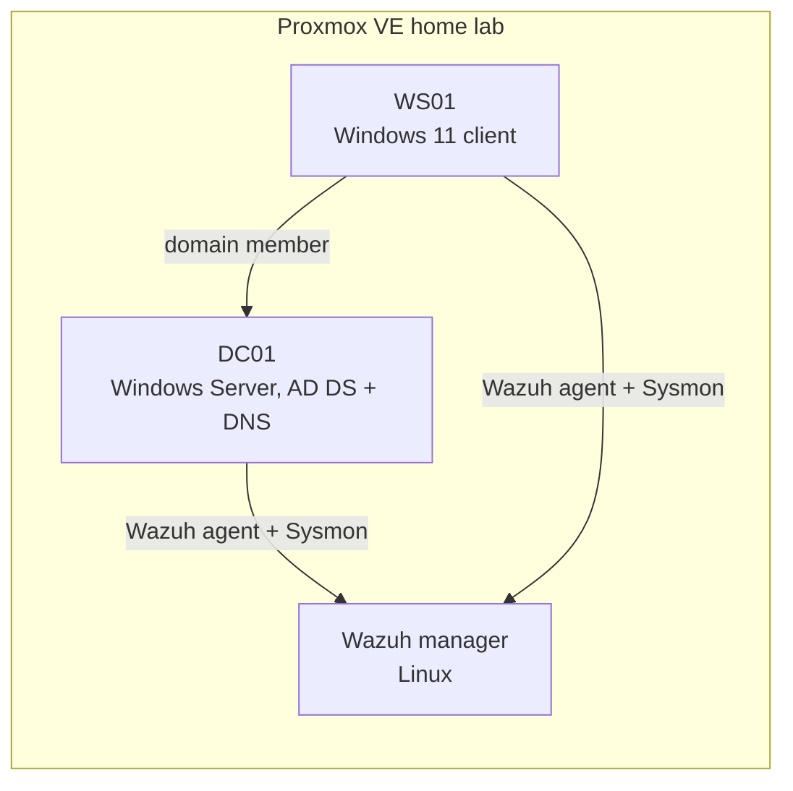

# ad-security-lab


An **Active Directory security lab** built in my Proxmox home lab: deploy a domain, harden it step by step, monitor it with **Wazuh** and **Sysmon**, and write detection use cases for the identity attacks most often seen in real incidents.

It extends what I do in my work-study position (deploying Active Directory and a Wazuh SIEM) in an environment where I can go further. **Everything here is built from scratch in my own lab: no company data.**

> **Status: in progress.** Phases are checked only when the work and its evidence are published.

---

## Architecture



---

## Phases

| Phase | Goal | Status |
|---|---|---|
| **1. Build** | Domain `lab.local`, OU structure, users, groups, DNS | Planned |
| **2. Harden** | Apply the [hardening checklist](docs/HARDENING_CHECKLIST.md): tiered admin, LAPS, Protected Users, SMB/LDAP signing, legacy protocols off | Planned |
| **3. Monitor** | Advanced audit policy, Sysmon, Wazuh agents, dashboards | Planned |
| **4. Detect** | Wazuh rules and Sigma rules for the use cases below, validated with controlled tests in the lab | Planned |
| **5. Report** | Audit score before and after hardening, lessons learned | Planned |

## Detection use cases

| Use case | Main signal (Windows Security log) | ATT&CK |
|---|---|---|
| Password spraying | Bursts of 4625 / 4771 failures across many accounts from one source | T1110.003 |
| Kerberoasting | 4769 service tickets requested with RC4 encryption | T1558.003 |
| AS-REP roasting | 4768 for accounts without Kerberos pre-authentication | T1558.004 |
| Directory replication abuse (DCSync) | 4662 replication rights used by a non-DC account | T1003.006 |
| Change to a privileged group | 4728 / 4732 / 4756 on admin groups | T1098 |
| Security log cleared | 1102 | T1685.005 |

The last two are already implemented and tested in my [detection-rules-lab](https://github.com/Emmanueltankam/detection-rules-lab) repository.

---

## Repository layout (as it grows)

```text
docs/HARDENING_CHECKLIST.md   Hardening steps, checked once verified
docs/evidence/                Screenshots and audit results per phase
scripts/                      PowerShell scripts used to build and harden the lab
detections/                   Wazuh rules and Sigma rules for the use cases
```

---

**Author:** Emmanuel Tankam Talla, cybersecurity engineering student (JUNIA ISEN), work-study at Dowsers.
